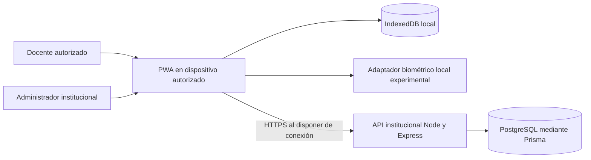

# Arquitectura propuesta

Actualización 2026-11-13: preparación de PostgreSQL/Prisma autorizada y reflejada
en [Fase 2 preparación](fase-2-preparacion.md) y [ADR 002](decisiones/ADR-002-prisma-local-preparacion.md).
Actualización de estado: ambas migraciones están comprobadas en sandbox, con
aceptación técnica explícita del responsable y 52/52 pruebas. Principal permanece
vacía; su migración requiere nueva autorización según el
[plan de migración](fase-2-plan-migracion-principal.md).
Se difiere persistencia de embeddings; Fase 1 sigue abierta.

## Alcance y estado

Diseño inicial sujeto a aprobación, no comportamiento implementado. Se revisaron
la solicitud, el cuerpo de `propuesta_original.docx` y los documentos numerados
cargados posteriormente. El responsable eligió el roadmap cargado, que
adelanta la viabilidad biométrica a Fase 1 y posteriormente autorizó su inicio.
El experimento implementado se describe en [Fase 1](fase-1.md); el resto de
esta arquitectura de asistencia sigue siendo propuesto. La biometría
se integrará solo si su evaluación aporta evidencia suficiente. Véanse
[diferencias y decisiones](conciliacion-fase-0.md) y
[contratos de adaptadores/API](contratos-fase-0.md).

## Vista C4 preliminar de contexto y contenedores



La frontera del dispositivo contiene interfaz, inferencia, cola y caché; la
frontera del servidor contiene autorización y persistencia central. El diagrama
es una vista preliminar, no un despliegue ni una decisión de proveedor.
Las seis capas académicas se corresponden con presentación, adaptador biométrico,
Dexie, sincronizador/Service Worker, API y PostgreSQL.

## Componentes y límites

```text
Operador -> React -> servicio local -> Dexie / IndexedDB
                       |                   |
                       |              cola de salida
                       |                   |
             adaptador ONNX          sincronizador -> Express -> Prisma -> PostgreSQL

Service Worker / Workbox -> recursos de aplicación para arranque offline
```

La interfaz no dependerá de una respuesta de red para confirmar una escritura
local. Solo mostrará éxito después de confirmar la transacción IndexedDB y
distinguirá pendiente, sincronizado, conflicto y error.
El Service Worker almacenará recursos estáticos versionados, no respuestas
autenticadas ni biometría de forma indiscriminada. La instalación inicial,
descarga de recursos y provisión del dispositivo requieren conexión.

El backend será responsable de autorización, validación, unicidad y auditoría.
Los permisos del cliente no constituyen una frontera de seguridad. Autenticación,
roles y duración de permisos offline deben definirse antes de usar datos sensibles.

## Persistencia y sincronización propuestas

Cada evento tendrá identificador UUID estable generado en el cliente, colegio,
identificador ficticio de estudiante, sesión de asistencia, método, dispositivo,
hora capturada y versión de contrato. El servidor agregará hora de recepción.
Los identificadores y marcas temporales del cliente no se considerarán prueba
de identidad ni de puntualidad.

La asistencia y su entrada en la cola de salida se escribirán en una misma
transacción Dexie. Los reintentos conservarán el identificador y contenido del
evento. El servidor confirmará cada elemento solo después del commit.
Una respuesta perdida deberá poder reintentarse sin insertar otro evento.

Se proponen dos controles distintos:

- Unicidad por colegio e identificador de evento para idempotencia de transporte.
  Reutilizar el identificador con contenido diferente generará conflicto explícito.
- Unicidad de asistencia activa por colegio, estudiante y sesión,
  para duplicados originados en dispositivos diferentes. La regla final depende
  de definir entradas, salidas, cursos, jornadas y correcciones.

Las restricciones PostgreSQL y transacciones deberán resolver carreras, no solo
consultas previas a insertar. Un conflicto no se descartará silenciosamente:
se conservará su trazabilidad para revisión autorizada. Las correcciones deberán
referenciar el registro original; no se decidirán por la última hora del cliente.

El sincronizador enviará lotes acotados con resultados por elemento. Aplicará
reintentos con espera creciente y variación aleatoria para fallos transitorios;
errores de validación o autorización requerirán intervención. Se activará al
abrir la aplicación, recuperar conectividad y mediante acción manual.
No dependerá exclusivamente de Background Sync ni de `navigator.onLine`.
La coordinación entre pestañas reducirá envíos simultáneos; la idempotencia del
servidor seguirá siendo obligatoria.

## Fechas y operación offline

Se propone conservar instantes en UTC y representar la jornada escolar con
`America/Guatemala`. La sesión escolar identificará el contexto de asistencia;
no se deducirá únicamente de la fecha del dispositivo. Se deben acordar reglas
para cambios de reloj, sesiones caducadas y permisos revocados mientras no hay red.

IndexedDB puede perderse por limpieza, cuotas o fallos del dispositivo. Solicitar
persistencia del navegador no equivale a una copia de seguridad. La interfaz
deberá advertir sobre registros pendientes y no ofrecer borrado automático de
estos. Deben definirse recuperación y conciliación antes de un piloto.

## Experimento biométrico

YuNet se evaluará como candidato de detección y SFace como candidato de
representación facial. Compatibilidad de exportación ONNX, operadores,
preprocesamiento, alineación, dimensiones y rendimiento deberán verificarse
con los archivos concretos. No se presume que los modelos funcionen directamente
en ONNX Runtime Web ni que los umbrales publicados sirvan para este escenario.

Antes de medir, se decidirá entre verificación 1:1 e identificación 1:N y se
documentarán licencia, procedencia, checksum y versión de cada modelo.
La inferencia se propone local, con procesamiento fuera del hilo principal
cuando sea viable y un camino manual ante incompatibilidad, denegación de cámara,
baja confianza o fallo. No se usarán servicios remotos de reconocimiento.

Datos sintéticos sirven para probar flujos, no para validar precisión real.
El protocolo con material autorizado deberá separar calibración y evaluación,
medir falsos positivos y negativos según el modo, latencia, memoria y condiciones
de iluminación. No se implementará asistencia automática basada en similitud
sin criterios aprobados. Detección facial no demuestra presencia física ni
resistencia a fotos, pantallas o suplantación.

## Privacidad y seguridad previstas

- Prohibida la biometría real de menores durante el prototipo.
- Identidades ficticias para pruebas de dominio y sincronización.
- No conservar fotogramas por defecto; limitar datos y duración de almacenamiento.
- No enviar imágenes ni embeddings en la cola de asistencia ni en logs.
- Tratar embeddings como información sensible, no como datos anónimos.
- Definir autorización, aislamiento por colegio, auditoría, retención y eliminación
  antes de cualquier piloto. La alternativa manual estará disponible sin biometría.
- Definir custodia de claves y cifrado según amenazas; IndexedDB por sí solo no
  protege frente a XSS ni frente a acceso al perfil del navegador.
- Planificar HTTPS fuera de localhost, políticas de contenido, validación de
  entrada y revisión de dependencias en sus fases correspondientes.

Este documento no acredita cumplimiento jurídico. La revisión institucional y
legal aplicable en Guatemala queda pendiente antes de tratar datos reales.

## Decisiones pendientes

Se deben acordar navegadores y dispositivos objetivo, cantidad de estudiantes y
terminales, máximo periodo offline, modelo de sesiones, roles, recuperación ante
pérdida de almacenamiento, retención, modo biométrico y umbrales de evaluación.
