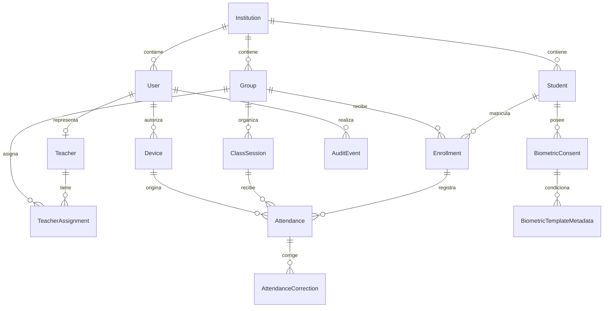

# Fase 2 — preparación de PostgreSQL y Prisma

Actualización posterior: el SQL inicial y una migración correctiva adicional se
aplicaron únicamente en sandbox. El defecto de integridad quedó corregido;
52 pruebas reales satisfactorias y baselining Prisma verificado. Una anomalía
temporal ficticia heredada permanece preservada para revisión. La principal
permanece intacta; consultar el [resultado vigente](evidencias/ensayo-postgresql-fase-2.md)
y la [decisión de integridad y episodios](decisiones/ADR-003-integridad-episodios.md).
El documento siguiente conserva la evidencia histórica de preparación.

Fecha: 13 de noviembre de 2026. **Preparación implementada; ninguna migración aplicada.**
La autorización cubre archivos, instalación de dependencias y pruebas sin escritura
en PostgreSQL. No se abrió una conexión a la base `asistencia_facial` durante esta tarea.
Fase 1 permanece abierta: Android físico, offline verificable y validaciones
complementarias siguen pendientes. No se modificó el frontend ni YuNet/SFace.

## Compatibilidad y configuración

| Componente | Versión | Evidencia / alcance |
| --- | --- | --- |
| Node.js | 24.20.0 | Ejecutado localmente; satisface engines de Prisma `^20.19 \|\| ^22.12 \|\| >=24.0` |
| PostgreSQL | 18.6 | Instalación/conexión comunicadas por el usuario; servidor no consultado por esta tarea |
| prisma, @prisma/client, @prisma/adapter-pg | 7.10.1 exactas | Instaladas; esquema validado y cliente generado |
| express / pg / dotenv | 5.3.0 / 8.23.1 / 18.0.10 | Dependencias exactas del backend |
| typescript / tsx | 7.0.2 / 4.23.15 | Compilación y pruebas locales |
| @types/node / @types/express / @types/pg | 24.10.1 / 5.0.6 / 8.23.1 | Dependencias de desarrollo exactas |

Fuentes oficiales consultadas: [configuración Prisma 7](https://www.prisma.io/docs/orm/v7/reference/prisma-config-reference),
[CLI migrate](https://www.prisma.io/docs/cli/v7/migrate),
[versiones de bases soportadas](https://docs.prisma.io/docs/orm/reference/supported-databases),
[actualización a Prisma 7](https://www.prisma.io/docs/guides/upgrade-prisma-orm/v7).
PostgreSQL 18 figura entre las versiones soportadas; no equivale a haber probado
esta migración en el servidor 18.6 instalado.

Una sola configuración: `apps/backend/prisma.config.ts`. El esquema declara el
proveedor, no la URL. `DATABASE_URL` pertenece al usuario de aplicación;
`MIGRATION_DATABASE_URL` al migrador. Ambos ejemplos están vacíos. No se creó un
`.env` ni se copiaron contraseñas. Ejecutar scripts desde el workspace backend.
El módulo de conexión es una fábrica explícita, no un singleton que abra la BD
al importarse. `/health` no consulta PostgreSQL; todavía no hay servidor escuchando
ni rutas de escritura o autenticación.

La configuración rechaza hosts remotos, puerto distinto de 5432, otra base,
roles intercambiados y parámetros de URL que puedan cambiar el destino. Esto no
reemplaza pg_hba.conf, permisos del SO ni comprobar que localhost no sea un túnel.
PostgreSQL debe escuchar solo en loopback; no se modificó su configuración.

## Esquema y relaciones

Esquema completo: [schema.prisma](../apps/backend/prisma/schema.prisma).
Los modelos institucionales usan clave compuesta `(institution_id, id)`; las
asignaciones usan `(institution_id, teacher_id, group_id)`. UUID se genera en
Prisma; los timestamps son `TIMESTAMPTZ(3)`. No hay extensión obligatoria.

| Modelo / tabla | Relación y restricciones principales |
| --- | --- |
| Institution / institutions | Raíz; nombre y fecha de creación |
| User / users | Institución; email canónico único por colegio; hash de contraseña, rol ADMIN/TEACHER, activo |
| Student / students | Institución; código único por colegio; nombre y activo |
| Teacher / teachers | Usuario 1:1 dentro del colegio; rol efectivo se comprobará en el servicio |
| Group / groups | Institución; año/grado/sección únicos, año 2000–2200 |
| Enrollment / enrollments | Estudiante + grupo del mismo colegio; pareja única y periodo válido; año derivado del grupo |
| TeacherAssignment / teacher_assignments | Docente + grupo del mismo colegio; activa/inactiva |
| ClassSession / class_sessions | Grupo; inicio anterior a fin; estado planificada/abierta/cerrada/cancelada |
| Device / devices | Usuario asignado del mismo colegio; caducidad y revocación |
| BiometricConsent / biometric_consents | Estudiante y actor; versión del aviso, referencia UUID opaca a evidencia protegida, fechas y revocación |
| BiometricTemplateMetadata / biometric_template_metadata | Consentimiento y estudiante coinciden por FK compuesta; solo metadatos DISABLED/REVOKED; sin vectores ni rutas a vectores |
| Attendance / attendances | Matrícula y sesión pertenecen al mismo grupo; actor/dispositivo del colegio; evento UUID único institucional, hash, método manual, estado y versión |
| AttendanceCorrection / attendance_corrections | Asistencia y actor; versión anterior/nueva, estados, motivo enumerado y fecha; versión destino única por asistencia |
| AuditEvent / audit_events | Actor institucional, acción, tipo y UUID de recurso, fecha; sin JSON libre ni copia de datos personales |



## Restricciones fuera de Prisma

El [SQL inicial previsto](../apps/backend/prisma/migrations/20261113000000_initial_review/migration.sql)
contiene 14 tablas, 6 enums y las FK/índices del esquema, envueltos en `BEGIN/COMMIT`.
Incluye el contenido de [invariants.sql](../apps/backend/prisma/invariants.sql):

- Índice único parcial de asistencia ACTIVE por institución/estudiante/sesión.
- CHECK de periodos, año, hash SHA-256, versión, método manual v1 y revocación.
- Trigger de inmutabilidad del contenido original de asistencia. Solo estado y
  versión cambian; comienza ACTIVE/v1 y no se permite borrar físicamente.
- Historial de correcciones y auditoría sin UPDATE/DELETE.
- Trigger diferido que exige corrección y auditoría coherentes al confirmar una
  actualización de asistencia; mismo actor de corrección y auditoría.
- RLS `ENABLE` + `FORCE` en las 14 tablas. Sin contexto institucional no hay
  visibilidad/escritura de filas. El helper usa `set_config(..., true)` dentro de
  una transacción para no dejar el colegio en una conexión devuelta al pool.

**Límite:** esto es SQL preparado, no validado mediante ejecución en PostgreSQL.
Las FK no comprueban usuario activo, rol docente, asignación vigente, matrícula
vigente ni permisos offline. Esas comprobaciones pertenecen al futuro servicio
autenticado. RLS tampoco impide que un backend comprometido seleccione otro
contexto: no es una solución contra SQL injection ni sustituto de autorización.
Se mantienen borrados restringidos; retención y anonimización requieren diseño
posterior y privilegios de mantenimiento separados.

## Contrato de asistencia manual y correcciones

`src/domain/attendance.ts` acepta exclusivamente `schema_version=1`, `event_uuid`,
`student_id`, `session_id`, `device_id`, `occurred_at_client` en UTC canónico con
milisegundos y `method=manual`. Rechaza campos extra (incluidos actor, colegio,
nombres, imágenes y embeddings). La institución y `created_by` se derivarán de
autenticación. Esto concreta el borrador Fase 0, que enviaba `created_by` pero
exigía comprobarlo en servidor; ahora no se acepta desde el cuerpo.

El hash SHA-256 usa una lista canónica de campos, incluyendo el actor autenticado.
Es un control de contenido, no anonimización, firma ni mecanismo de autorización.
Mismo UUID/contenido devuelve `already_accepted`; otro contenido, `needs_review`.
La unicidad lógica resuelve eventos distintos para la misma asistencia activa.
No hay aún endpoint, repositorio de escritura ni ACK persistido.

Transacción futura por evento: autenticar y autorizar; fijar contexto; buscar UUID;
comparar hash o insertar asistencia + auditoría; confirmar; recién entonces emitir
ACK. Una carrera de unicidad requiere releer en una nueva transacción después
del rollback. No devolver ACK ante error de commit. Hora cliente es declarativa;
hora servidor se asigna al persistir. Reintentar incluso una asistencia anulada
con el mismo UUID reconoce el evento original, nunca la reactiva.

Corrección: UUID estable `correctionId`, asistencia, versión esperada, estado
destino y motivo enumerado. En una transacción: revisar autorización, comprobar
si corrección ya existe y comparar contenido, actualizar con predicado de versión,
insertar historial y auditoría, confirmar. Una versión obsoleta genera conflicto.
Restaurar ACTIVE puede chocar con el índice parcial y debe revertir toda la
transacción. Corregir estudiante/sesión exige anular y crear un nuevo evento
auditado; no reescribir contenido histórico. No se implementó todavía ese servicio.

## Consentimiento, cifrado y revocación

Se difiere explícitamente `encrypted_embedding` del borrador original. El modelo
actual no almacena imágenes, embeddings, claves ni referencias de almacenamiento
biométrico. El usuario app no recibe permisos sobre la reserva de metadatos.
No se ha añadido persistencia al experimento de Fase 1.

Diseño futuro sujeto a revisión: sobre AES-256-GCM con nonce único, tag y versión;
AAD que vincule colegio, sujeto, consentimiento y modelo; claves de datos separadas
de PostgreSQL y de las claves maestras; custodia local con acceso por servicio,
rotación y destrucción verificable. La tabla personal nunca contendrá la clave.
Exportar a dispositivos exige autorización por grupo, TTL offline y claves
limitadas; no asumir protección frente a XSS/extracción del perfil del navegador.

Revocar: registrar actor/fecha/motivo, impedir nuevas entregas y generar tombstone
para borrado local; purgar vectores y claves según política, conservar solo auditoría
mínima. Desconexión impide revocación inmediata: definir ventana máxima antes de
habilitar plantillas. Nueva autorización se registra como nuevo consentimiento,
sin borrar el histórico. Referencia de evidencia es opaca: ningún documento de
identidad o fotografía se guarda en auditoría. Retención, evidencia de tutor y
evaluación legal quedan pendientes; en el prototipo no se permite biometría de menores.

## Permisos y puerta previa a cualquier migración

| Rol | Permisos previstos | Prohibiciones |
| --- | --- | --- |
| asistencia_app | CONNECT/USAGE; SELECT/INSERT/UPDATE acotados; correcciones y auditoría solo anexar | Sin propiedad, CREATE, CREATEDB, CREATEROLE, SUPERUSER, BYPASSRLS, membresía migrador, DELETE/TRUNCATE o acceso a tabla de migraciones/plantillas |
| asistencia_migrator | CONNECT/USAGE/CREATE en public; propietario de objetos migrados | Sin SUPERUSER/CREATEDB/CREATEROLE/BYPASSRLS; credenciales fuera de la aplicación |
| Administrador local | Provisionar roles y revisar propiedad/grants | No usado por la API |

**Permisos efectivos pendientes de verificar.** No se leyó ninguna contraseña ni
se usó la conexión real. `psql` no estaba en PATH en la revisión previa; localizar
su ejecutable o configurar PATH antes del procedimiento. No asumir que la conexión
psql exitosa del usuario acredita mínimo privilegio.

Antes de migrar, ejecutar con autorización [preflight-readonly.sql](../apps/backend/prisma/preflight-readonly.sql)
por separado para ambos roles. Deben existir, ser login, no privilegiados, no
compartir membresías elevadas; app no debe ser propietario de base, esquema ni
tablas, ni tener CREATE efectivo. Revisar cualquier tabla preexistente: esta es
una migración desde vacío, no un procedimiento de baseline. Detenerse ante
discrepancias de host, versión, base, propietarios o membresías.

[roles-review.sql](../apps/backend/prisma/roles-review.sql) es el plan previo;
[permissions-review.sql](../apps/backend/prisma/permissions-review.sql), el plan
posterior a crear tablas. **No ejecutados.** Los REVOKE no neutralizan propiedad
ni todas las membresías; corregirlas con un plan específico revisado. No usar
grants generales automáticos para futuras tablas. Crear contraseñas mediante
`psql \password`, sin incluirlas en comandos versionados ni capturas.

## Comandos reproducibles sin BD

Instalaciones ejecutadas desde la raíz (versiones guardadas en package y lockfile):

```powershell
npm.cmd install -w apps/backend --save-exact @prisma/client@7.10.1 @prisma/adapter-pg@7.10.1 pg@8.23.1 express@5.3.0 dotenv@18.0.10
npm.cmd install -w apps/backend --save-dev --save-exact prisma@7.10.1 typescript@7.0.2 @types/node@24.10.1 @types/express@5.0.6 @types/pg@8.23.1 tsx@4.23.15
```

Desde la raíz:

```powershell
npm.cmd run prisma:validate -w apps/backend
npm.cmd run prisma:generate -w apps/backend
npm.cmd run typecheck -w apps/backend
npm.cmd run build -w apps/backend
npm.cmd run test -w apps/backend
npm.cmd test
```

Para regenerar **solo una comparación**, sin sobrescribir el SQL revisado:

```powershell
Set-Location apps/backend
node ../../node_modules/prisma/build/index.js migrate diff --from-empty --to-schema prisma/schema.prisma --script
```

La CLI 7.10.1 terminó inicialmente con código 0 sin SQL cuando faltaba datasource;
el diagnóstico mostró que el motor exigía `--datasource`. La configuración ahora
proporciona **solo a diff desde vacío a esquema** una URL ficticia
`127.0.0.1:1/offline_schema_only`, sin secreto ni destino real. Ese diff no accede a
BD ni necesita sombra. Para los demás comandos no hay URL predeterminada.
Se verificó el archivo producido y una prueba compara su parte generada con el
esquema, además de conservar los invariantes. No aceptar solo el código de salida.

## Aplicación futura: NO ejecutada, requiere nueva autorización

1. Revisar SQL, permisos y modelo. Primero ensayar la migración y pruebas de
   integridad/RLS en PostgreSQL 18 aislado desechable, con autorización específica.
   No usar SQLite para afirmar que funcionan RLS, enums o triggers PostgreSQL.
2. Localizar `psql` y `pg_dump` de PostgreSQL 18. Confirmar destino local y revisar
   preflight con ambos roles. No continuar si hay tablas incompatibles o permisos
   excesivos. Provisionar roles con administrador; aplicar plan previo revisado.
3. Respaldar base, propietarios y permisos. `backups/` está excluido de Git;
   proteger su ACL y comprobar una restauración en otra base aislada autorizada.
   Un archivo de dump existente no prueba que pueda restaurarse.
4. Configurar `apps/backend/.env` local con credenciales distintas; ejecutar
   comandos desde `apps/backend`. Nunca pasar contraseña en argumento.
5. Solo después de aprobación expresa ejecutar la migración versionada:

```powershell
# EJEMPLOS FUTUROS; no ejecutados por esta tarea.
psql -h localhost -p 5432 -U asistencia_app -d asistencia_facial -W -v ON_ERROR_STOP=1 -f prisma/preflight-readonly.sql
psql -h localhost -p 5432 -U asistencia_migrator -d asistencia_facial -W -v ON_ERROR_STOP=1 -f prisma/preflight-readonly.sql
# Crear previamente backups/ desde la raíz, con ACL local restringida.
# Usar un operador de respaldo autorizado; migrador sin BYPASSRLS no basta para respaldar datos bajo RLS.
pg_dump -h localhost -p 5432 -U OPERADOR_RESPALDO -d asistencia_facial -W -Fc -f ../../backups/asistencia_facial_pre_migracion.dump
node ../../node_modules/prisma/build/index.js migrate status
node ../../node_modules/prisma/build/index.js migrate deploy
```

`migrate deploy` aplica migraciones a la BD local: su nombre no implica publicar
el proyecto, pero **sí escribe**, por eso no se ejecutó. No usar `db push`, reset
ni `migrate dev` sobre esta base. Después aplicar grants revisados y ejecutar
`verify-readonly.sql` con migrador, y preflight con app. Comprobar 14 tablas,
6 enums, índice parcial, triggers, RLS forzada, propietario migrador y registro
de migración finalizado. No habilitar endpoints hasta aprobar ensayos de permisos.

Pruebas futuras con identidades ficticias: acceso cruzado y sin contexto; reintento
con respuesta perdida; UUID alterado; dos eventos concurrentes; matrícula/sesión
de otro grupo; rollback; corrección sin auditoría; versión obsoleta; append-only;
app sin DDL/TRUNCATE; aislamiento de conexiones reutilizadas; revocación/expiración.

Reversión: el SQL inicial es transaccional; comprobar estado tras cualquier error.
No editar una migración ya aplicada ni marcarla resuelta sin verificar. Prisma no
provee un `down` automático seguro: preparar migración compensatoria revisada o
restaurar el respaldo en una base separada y comprobarlo antes de sustituir la
base local. Cualquier borrado, cambio de destino o restauración requiere nueva
autorización. No se incluye un script de DROP/reset.

## Pruebas realmente ejecutadas y problemas

| Verificación | Resultado real | Límite |
| --- | --- | --- |
| `prisma validate` | Correcto | Gramática/relaciones Prisma, no SQL ejecutado |
| `prisma generate` | Cliente 7.10.1 generado | Sin conexión de BD |
| `tsc --noEmit` y `tsc` backend | Correctos | Compilación, no prueba de servidor PostgreSQL |
| Tests backend | 13/13 correctos | Contratos, hash, correcciones, URL, cliente sin consultas, helper con doble de transacción y SQL reproducible |
| `npm.cmd test` frontend | 16/16, 2 archivos | Regresión unitaria existente; no Android ni ensayo facial humano |
| `git check-ignore` | `.env` backend y cliente generado excluidos | No se crearon secretos |
| `npm audit --json` | Código 1: 15 paquetes afectados; 11 moderados y 4 bajos; 0 altos/críticos | Conteo incluye dependientes, no 15 fallos independientes |

La instalación inicial falló por EPERM en caché npm; se reintentó con autorización
de ejecución ampliada. `tsx` falló en sandbox con `uv_os_get_passwd ENOMEM`; la
misma suite pasó al ejecutarse fuera de esa restricción. No se cambió código para
ocultar esos errores. npm avisó de scripts de instalación pendientes de cobertura
allowScripts para Prisma/engines/esbuild/protobufjs; generación y compilación
funcionaron sin aprobación global de scripts. La consulta directa al package.json
exportado de adapter-pg falló por exports; versiones constan en manifest/lockfile.

Auditoría: cadenas de Prisma dev/streams-local/ajv/fast-uri y herramientas PWA
existentes (workbox, glob/minimatch, deepmerge, serialize-javascript). El informe
no ofreció arreglo automático; no se ejecutó `npm audit fix`, no se cambiaron
YuNet/SFace ni dependencias del frontend. Evaluar alcance de los avisos antes de
habilitar servicio; mantener las versiones exactas aprobadas por ahora.

## Inventario y pendientes

Creado: esquema/configuración/SQL inicial + invariantes + preflight/verificación +
planes de roles/grants, conexión pg, app Express mínima, dominio de asistencia,
13 pruebas, tsconfig, `.env.example` backend, este informe y ADR 002.
Modificado: package backend, lockfile raíz, README backend, AGENTS, `.gitignore`,
ejemplo de entorno raíz y enlaces de estado en arquitectura/roadmap/tecnologías,
modelo de datos y contratos históricos.
Cliente generado y dist son artefactos excluidos. Todo el repositorio ya estaba
sin seguimiento en Git al inicio; se conservaron archivos existentes, sin commits.

Pendiente: revisión del esquema/SQL, permisos reales, respaldo/restauración,
ejecución SQL en entorno aislado y posteriormente migración local autorizada;
autenticación/API y pruebas integradas; política de matrícula múltiple, vigencia
offline, retención y borrado; revisión de claves y seguridad; ensayos Fase 1 aún
abiertos. Se recomienda aceptar esta preparación para revisión, **no declarar
la integración PostgreSQL operativa ni la Fase 2 terminada**.
